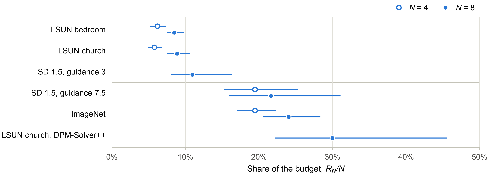

# Per-sample step placement at a fixed budget

Code and data for the technical report
[*How Much Is Per-Sample Step Placement Worth at a Fixed Budget?*](How%20Much%20Is%20Per-Sample%20Step%20Placement%20Worth%20at%20a%20Fixed%20Budget%20Latest.pdf)
(technical report, v1, November 2026, not peer reviewed).

For each image, we search for the timestep schedule that brings it closest, in LPIPS, to a
200-step reference from the same noise, and compare it with the best shared schedule at the
same number of denoising evaluations. At 4 and 8 evaluations, per-sample placement is worth
about 6–9% of the budget for DDIM on LSUN church and bedroom, and 19–30% on ImageNet,
Stable Diffusion 1.5 at guidance 7.5, and DPM-Solver++ on church. A tuned shared schedule
already provides 29–84% of the improvement over uniform spacing, so a per-sample method
should be compared with a tuned shared schedule at the same budget.



## Reproducing the results

Every number, table and figure from the full rollouts is computed from the run files in
`data/rollouts/`, on CPU, in a few seconds:

```bash
pip install numpy matplotlib
python rollouts/paper_numbers.py --root data/rollouts --out build/paper
python rollouts/paper_figures.py --dir build/paper/figures --steps-root .
```

`--steps-root .` adds the local-error profile figure, which reads `data/profiles/` through
the `steps` package in `src/`.

`paper_numbers.py` writes `numbers.tex`, the table rows and the figure data that the report
uses. It also checks 40 statements the text makes, such as which intervals exclude one, and
exits non-zero if any of them fails. Intervals are BCa intervals from 10,000 bootstrap
resamples of the images with seed 0.

The local-error results (Section 5 of the report and the search check in Appendix I) come
from the profiles in `data/profiles/`:

```bash
pip install -e .
python scripts/check.py
```

`check.py` comes from the earlier version of the report. Its LPIPS-advantage table uses the
original shared schedules; the current report replaces those values with the refined ones
that `paper_numbers.py` computes.

## Layout

```
rollouts/          full-rollout study
    search_vs_sample.py      shared and per-image searches, DDIM on LSUN
    search_vs_sample_v2.py   the same search for ImageNet and DPM-Solver++
    search_sd.py             the same search for Stable Diffusion 1.5 on COCO captions
    search_denominator.py    per-image scores at N+1, for the interval of the denominator
    uncap.py                 continues the per-image searches that reached the sweep limit
    shared_check.py          refines the shared schedules; uniform-spacing scores
    sd_more.py               the same for Stable Diffusion, and its reference check
    ref_floor.py             200-step against 999-step reference
    sd_checks.py             PSNR, DISTS and the fixed-schedule sets on Stable Diffusion
    reward_structure.py      rollout, decoding and LPIPS helpers
    curvature_probe.py, solver_probe.py, romberg_dpm_sampler.py, adapter_compvis.py
                             imported helpers
    bootstrap.py             intervals for every row, paired comparison and budget trend
    paper_numbers.py         every number and table in the report
    paper_figures.py         the figures
    paper_samples.py         the example-image figure (needs the PNGs from sd_checks.py)
data/rollouts/     run outputs read by the CPU scripts, and sd_prompts.tsv
src/steps/, scripts/, generators/, data/profiles/, data/runs/
                   local-error study (Section 5)
```

## Re-running the GPU stage

The GPU scripts need a CUDA device, PyTorch, the `lpips` package, `diffusers` for Stable
Diffusion, and the [latent-diffusion](https://github.com/CompVis/latent-diffusion)
repository for the model configs. Checkpoints are not redistributed:

- LSUN church, LSUN bedroom and ImageNet: the `lsun_churches256`, `lsun_beds256` and
  `cin256` latent diffusion checkpoints from the latent-diffusion repository. Set
  `TAED_LDM_ROOT` to the folder that holds `<name>/model.ckpt`.
- Stable Diffusion 1.5:
  [`stable-diffusion-v1-5/stable-diffusion-v1-5`](https://huggingface.co/stable-diffusion-v1-5/stable-diffusion-v1-5),
  with its fp16 weights.
- COCO-2017 validation captions (`captions_val2017.json`) from
  [cocodataset.org](https://cocodataset.org).

Each script lists its flags with `--help`. The outputs map to scripts as follows:

| files in `data/rollouts/` | script |
| --- | --- |
| `search_church256_*_sw10.*`, `search_bedroom256_*_sw10.*` (DDIM) | `search_vs_sample.py` |
| `search_cin256_*_sw10.npz`, `search_church256_B8_n64_sw10_dpmpp2m.npz` | `search_vs_sample_v2.py` |
| `search_sd15_coco_*` | `search_sd.py` |
| `denom_*`, `*_denom.npz` | `search_denominator.py` |
| `uncap_*` | `uncap.py` |
| `shared_*`, `rescore_*`, `round2_*`, `uniform_*` | `shared_check.py` |
| `sdrescore_*`, `sdround2_*`, `sduniform_*`, `refloor_sd15_*` | `sd_more.py` |
| other `refloor_*` | `ref_floor.py` |
| `sdpost_*` | `sd_checks.py` |

The runs used one V100 per job. Searches take from minutes to several hours per row.

## Data

- `data/rollouts/runs1/`, `data/rollouts/runs2/`: NPZ arrays with the searched
  schedules, the per-image LPIPS scores and the shared-schedule scores at N and N+1, plus
  the logs of the original searches, which `bootstrap.py` reads for the per-image baseline.
  Paths in the logs are shortened.
- `data/rollouts/sd_prompts.tsv`: the 64 COCO-2017 validation captions with their image and
  annotation ids and the noise seed of each prompt.
- `data/profiles/`, `data/runs/`: the local-error profiles and runs of the earlier version.

No generated images or checkpoints are included.

## Caveats

- Each per-image search scores against that image's own reference, which a deployed
  predictor does not have, so the gains are the upper end of what a predictor could get.
- Coordinate descent is a local search. Appendix C of the report lists how much refining
  the shared schedules changed each row.
- LPIPS to a same-noise reference measures fidelity to the model's many-step output, not
  distributional quality.
- Each setting uses one model. Stochastic samplers, flow-matching models and distilled
  few-step models are not tested.

## Citation

```bibtex
@misc{ravula2026stepplacement,
  title  = {How Much Is Per-Sample Step Placement Worth at a Fixed Budget?},
  author = {Ravula, Karthik},
  year   = {2026},
  month  = nov,
  note   = {Technical report, v1},
  url    = {https://github.com/karthik6281/Adaptive-Step-Allocation-for-Diffusion-Sampling}
}
```

## License

MIT. The COCO captions in `sd_prompts.tsv` and in the Stable Diffusion run files belong to
the COCO Consortium and are licensed under CC BY 4.0. The diffusion checkpoints are not
redistributed and carry their own terms.
