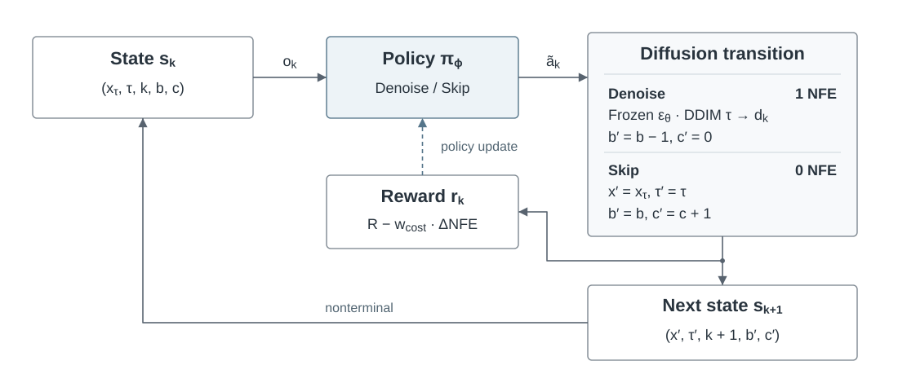
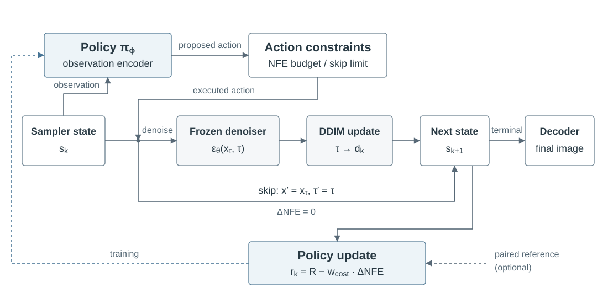

# TAED

TAED learns when to denoise and when to skip while sampling from a frozen
diffusion model. It allocates a per-sample budget of denoiser evaluations
(NFE) without updating the image generator.

## Method

### Decision process



The sampler state is `s_k = (x_τ, τ, k, b, c)`: latent/pixel tensor, held source
timestep, grid decision index, remaining NFE budget, and consecutive-skip count.
`d_k` is the current grid destination. Class labels and the optional paired
reference are fixed episode context.

`o_k` is a policy observation, not necessarily this entire state. LSTMs
receive the tensor, source timestep, recurrent hidden state, and optional labels;
planning heads can additionally use budget/grid features.

`ã_k` denotes the policy proposal and `a_k` the executed action. Budget, warmup,
skip-limit, and terminal conditions can override a proposal. **Denoise (0)**
calls the frozen predictor at `τ` and DDIM-jumps to `d_k`; `x′` is the resulting
tensor. It spends one NFE and resets the skip streak. **Skip (1)** holds `x_τ`
and `τ`, spends no NFE, and increments the streak. Both advance `k`.
Warmup and terminal calls count toward the budget.

### Architecture



The trainable encoder/policy `π_ϕ` proposes actions; constraints control the
frozen predictor `ε_θ` and DDIM update. Skip bypasses both computations, and
the terminal state is decoded to the output image.

Training and evaluation share this sampler; the backbone stays frozen.
`R` is the weighted sum of image reward terms, evaluated on decoded images.
`ΔNFE` is 1 for denoise and 0 for skip; `w_cost` is the configured cost weight.
Paired references use the same initial noise and class label.
Only the policy is optimized; forced decisions are excluded from actor and
entropy losses. Policy replay reuses the stored action-diffusion noise.

## Run locally

Use **Python 3.10 or 3.11** and Git. Run commands from this project directory:

```bash
python3.10 -m venv .venv
source .venv/bin/activate
python -m pip install -r requirements.txt
python -m pip check
```

Dependencies are pinned in [pyproject.toml](pyproject.toml) and
[constraints.txt](constraints.txt). Alternatively, use
`conda env create -f environment.yaml` and `conda activate taed`.

### Offline CPU example

```bash
python run_rl.py --config examples/toy.yaml --output-dir runs/toy
python run_eval.py --checkpoint runs/toy/latest.pt \
  --output-dir runs/toy-eval --num-samples 5 --batch-size 2 --metric mse
```

The [toy example](examples/toy.yaml) needs no pretrained weights or network
after installation. Its analytic denoiser tests the workflow, not image quality.

To stop and resume without changing the configured learning-rate schedule:

```bash
python run_rl.py --config examples/toy.yaml \
  --output-dir runs/resume-demo --stop-after 2
python run_rl.py --config examples/toy.yaml --output-dir runs/resume-demo \
  --resume runs/resume-demo/latest.pt
```

Use fresh output directories except when resuming the same run. Exact resume
requires matching code, settings, assets, and environment; it restores optimizer,
scheduler, reward statistics, and RNG state as well as policy weights.

Run folders contain metadata, raw samples, PNG previews, and diagnostic plots.
`latest.pt` stores post-update training state; training previews show the
pre-update rollout. Evaluation exports every sample and records per-sample NFE.
The default `--metric none` generates no reference. `mse` and `lpips` measure
paired agreement with a fixed DDIM reference, **not FID or distributional quality**.
Recorded wall time includes reference generation and rendering, not just sampling.

## Pretrained experiments

TAED supports CompVis latent models and Diffusers image pipelines. Weights are
external. Follow the asset setup below before running the supplied example.

<details>
<summary>Pretrained assets and optional rewards</summary>

Use the pinned CompVis source:

```bash
git clone https://github.com/CompVis/latent-diffusion.git external/latent-diffusion
git -C external/latent-diffusion checkout --detach a506df5756472e2ebaf9078affdde2c4f1502cd4
export TAED_COMPVIS_ROOT="$PWD/external/latent-diffusion"
```

Get released weights from the
[CompVis model instructions](https://github.com/CompVis/latent-diffusion#model-zoo).
For the church example, place `model.ckpt` in `checkpoints/lsun_churches256/`.
Other dataset paths are defined in [adapter_compvis.py](adapter_compvis.py).
`TAED_LDM_ROOT` overrides the checkpoint root; explicit asset paths in YAML are
relative to that file. Only trusted checkpoints should opt into
`model.trust_checkpoint: true`, which permits Python-object loading.

For Diffusers, set `model.kind: diffusers` and `model.model_id` to a local
pipeline or a remote model with a 40-character commit SHA in `model.revision`.
Pixel and VQ-latent image pipelines are supported; text conditioning is not.

The eight [reward terms](training/advanced_reward.py) are opt-in through
`reward.w_*` weights. `w_perceptual` enables paired LPIPS and may download its
pretrained assets. Manifold and handcrafted rewards are heuristics, not
validated quality measures. For manifold rewards, build a bank from licensed
local images:

```bash
python -m tools.build_manifold_bank --images /path/to/images \
  --encoder dinov2b --device cuda:0 --output data/bank.pt
```

Set a positive `reward.w_manifold`, matching `reward.manifold_encoder`, and
`reward.manifold_bank_path` (`../data/bank.pt` for a YAML in `examples/`).
Add `--class-folders` for image directories named by integer class labels.

</details>

```bash
python run_rl.py --config examples/church256.yaml --output-dir runs/church
python run_eval.py --checkpoint runs/church/latest.pt --device cuda:0 \
  --output-dir runs/church-eval --num-samples 256 --batch-size 16 --metric lpips
```

[church256.yaml](examples/church256.yaml) uses an exact 16-NFE budget on a
200-decision grid. It is an experiment configuration, not a tuned quality result.

## Supported scope

Controllers include LSTM/CIFAR-LSTM, direct action plans, and action-diffusion
plans. Training supports A2C, PPO, GRPO, and optional recurrent TBPTT.
Optional Mamba heads are single-token ablations, not recurrent controllers.

Sampling uses deterministic DDIM (`eta=0`). CPU workflows and synthetic CompVis
integration tests do not establish pretrained image quality or full GPU/Mamba
correctness; multi-GPU execution is not validated. Equal seeds do not guarantee
bitwise agreement across hardware or library versions.

```bash
ruff check . && ruff format --check .
python -m pytest -m "not compvis"
TAED_COMPVIS_ROOT="$PWD/external/latent-diffusion" python -m pytest -m compvis
```

## Attribution and licensing

[Transformer helpers](dasp/diffusion_transformer) are adapted from
[Diffusion Policy](https://github.com/real-stanford/diffusion_policy), with its
[MIT notice](LICENSE-DIFFUSION-POLICY) included. This is not a project-wide TAED
license. External libraries, pretrained weights, and datasets retain their
respective licenses.
